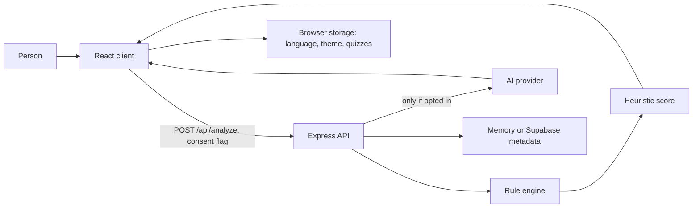

# Architecture

SURAKSHIT is a small web application. The browser explains a check. The API owns the score.

## Components

- **Client.** A React application. It collects a message or URL, calls the API, and renders the band, the matched rules, and the next steps. English and Tamil strings live in dictionaries. Language, theme, and quiz scores stay in the browser.
- **API.** An Express server. It validates input, rate-limits analysis calls, runs the rules, and optionally asks an AI provider for a note. It never opens a submitted URL.
- **Detection engine.** Pure functions under `server/src/detectors`. Message checks and URL checks are separate. Each check returns at most one finding. A scoring step discounts overlapping findings in the same group.
- **Optional AI provider.** A server-side client for an OpenAI-compatible chat endpoint. It is used only when `AI_API_KEY` is set and the person opts in. The numeric score is not taken from the model.
- **Optional database.** Supabase can store anonymized check metadata. Without it, the API keeps a short in-memory session and, until the first check, shows illustrative demo figures.

## Data flow

1. The person pastes a message or an address. The form checks length locally. The API checks it again.
2. The rule engine normalizes the text or parses the URL with the platform URL parser. It does not resolve DNS and it does not send an HTTP request to the address.
3. Findings are grouped and capped. The total becomes a band: low, medium, high, or critical.
4. If the person opted in and a key exists, the API sends a redacted prompt to the AI provider. Userinfo and query values are removed from URLs. Digit runs of five or more are removed from messages. A failure returns the rule result unchanged.
5. The API stores the band, score band, indicator codes, language, and whether AI was used. It does not store the message or the address.
6. The client translates the codes and shows the result. A copied summary includes the band, the score, and the pattern titles. It does not include the submitted text.

## Privacy boundaries

| Data | Browser | API memory | Supabase | AI provider |
| --- | --- | --- | --- | --- |
| Raw message or URL | Kept only on the page until it is cleared | Not stored | Not stored | Only with opt-in, and secrets are stripped first |
| Indicator codes, band, language | Shown in the result | Session list, capped | Optional rows | Codes are included in the prompt when AI is used |
| Quiz score | `localStorage` | No | Schema exists, unused by the MVP | No |
| API keys | Never | Process environment | Service role stays on the server | Sent only as the server's Authorization header |

Row Level Security is enabled and forced on both tables. No policies are granted to the anonymous or authenticated roles. The service role bypasses RLS and must not be placed in a `VITE_` variable.

## AI fallback

The rules always run first. AI is skipped when consent is off or `AI_API_KEY` is empty. Network errors, timeouts, and replies that fail the response schema set `ai.used` to false and leave the score untouched. The interface says which of those happened.
